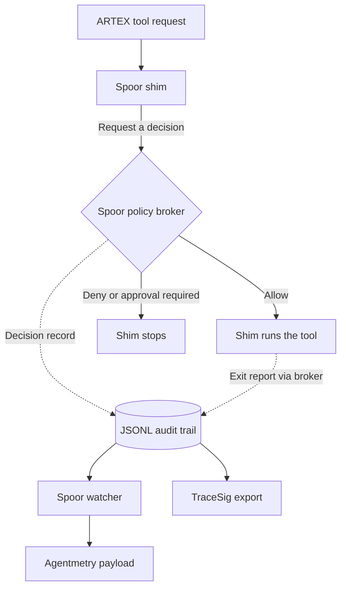
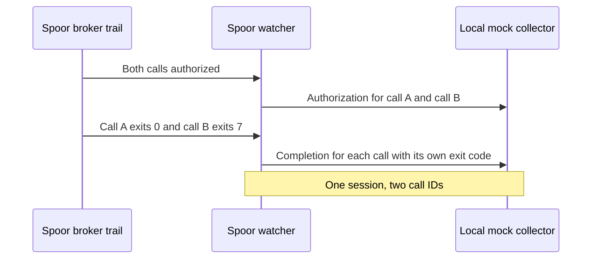

#  Spoor

**Follow an ARTEX tool call from policy decision to audit evidence.**

[](rust/Cargo.toml)
[](https://github.com/blitzcrieg1/spoor/actions/workflows/ci.yml)
[](LICENSE)
[](#verification)

An ARTEX worker asks to run a tool. Spoor can show what it requested, whether
policy allowed it, and what the tool reported afterward. It's an experimental
Rust broker and audit bridge for calls instrumented in a controlled lab.

Microsoft and the FBI documented ARTEX use in real intrusions in November 2026.
Spoor gives defenders a small, reproducible way to study the tool-call evidence
an instrumented agent can leave. [Microsoft Threat Intelligence](https://www.microsoft.com/en-us/security/blog/2026/11/06/artex-abuse-expands-as-cybercriminals-target-financial-sector/) · [FBI advisory](https://www.ic3.gov/CSA/2026/261113.pdf)

[Try a synthetic trace](#try-a-synthetic-trace) ·
[Explore the detections](#detection-rules) ·
[See what has been verified](#verification)

## Where Spoor sees the call



The broker gives each decision a call ID. An allowed tool's report uses that ID,
and Spoor keeps the original session, command, and parent metadata. On Linux the
shim samples the parent command and redacts common credential patterns.

## Try a synthetic trace

Use a stable Rust toolchain with Cargo and Python 3.10 or newer. The same
command works in PowerShell and Bash. It starts the real shim, broker, and
watcher with a loopback mock collector. Two harmless tool calls share one
session, with exit codes 0 and 7. The demo checks each decision against its
own completion, simulates a collector and retry queue outage, and checks that
strict audit refuses a call it cannot record.

```sh
python scripts/run_synthetic_trace.py
```

### Read the two events together



Join the two phases using `tool.arguments.call_id`. Use `session_id` to group
related calls.

| Phase | Spoor event | Meaning |
| --- | --- | --- |
| `authorization` | `tool_authorized` | Policy allowed the request. Execution is pending. |
| `authorization` | `tool_denied` or `approval_request` | Policy blocked the request or required approval. |
| `completion` | `tool_called` or `tool_failed` | The shim reported exit code 0 or a nonzero exit code in `tool.arguments.exit_code`. |

## Detection rules

- [Sigma](detections/sigma) covers brokered completion reports with ARTEX or
  shell parent metadata, plus web log signals such as ARTEX user agents. The
  process rule uses the phase field preserved in stored Agentmetry events.
- [Suricata](detections/suricata/artex-lab.rules) looks for ARTEX HTTP signals
  where the relevant traffic is visible.
- [TraceSig](detections/tracesig/lab_rules.yml) looks for sequences across the
  audit trail, including scope drift and risky data movement.

Use these experimental matches as leads to investigate alongside the rest of
the event and your environment's baseline.

## Repository layout

| Path | Contents |
| --- | --- |
| `rust/spoor` | Broker, audit watcher, model request proxy, and TraceSig exporter |
| `rust/spoor-core` | Policy, event mapping, deduplication, and signal matching |
| `rust/spoor-shim` | Tool mediation and Linux parent command capture |
| `rust/policy.json` | Example policy from the local lab |
| `detections` | Experimental Sigma, Suricata, and TraceSig rules |
| `examples` | A sample broker trail |

## Verification

[CI](https://github.com/blitzcrieg1/spoor/actions/workflows/ci.yml) builds the
checkout, runs the Rust tests and this quick start, and checks the Sigma
process fixtures on Linux and Windows.

The live loopback check read four stored events back from Agentmetry. Two
distinct call IDs shared one session and each linked the authorization
to its exit code and outcome. The tested instance normalizes both phases to
`action.type=tool_called`. Query by `tool.arguments.phase` to distinguish
them. The source topic retains the original Spoor event name.

Earlier broker trails with call IDs can be read through the updated watcher.
Consumers that used `tool_called` as a policy decision should use the
authorization phase going forward.

Build and test the Rust workspace.

```sh
cargo build --locked --manifest-path rust/Cargo.toml --workspace
cargo test --locked --manifest-path rust/Cargo.toml --workspace
```

The focused process rule fixture check uses Python and PyYAML.

```sh
python scripts/evaluate_lab_sigma.py
```

## Deployment limits

The broker listens on loopback by default and assumes a trusted client. Use
operating system and network controls for isolation. Review the example
policy, which permits unmatched commands.

Set `SPOOR_STRICT_AUDIT=1` on the broker to refuse otherwise allowed calls if
the decision cannot be appended to the local trail. Audit write errors are
logged in both modes. An unrecorded completion is rejected by the broker and
reported by the shim.

The watcher holds its checkpoint when it can neither deliver an event nor
flush it to the local retry queue. A running watcher retries from the blocked
record. Queued events are replayed at startup. A single run returns an error
if it is blocked. Delivery can repeat after a restart or an ambiguous ingest
response, so consumers should handle duplicate events.

The optional HTTPS proxy uses the platform TLS trust store and keeps request
headers and bodies in memory. It connects directly to its configured upstream
and returns redirects to the caller. Linux source builds need the OpenSSL
development libraries. The Linux HTTPS test also uses the `openssl` executable
to create a temporary loopback certificate.

Audit trails can contain command arguments and model prompt content. Parent
command redaction covers common credential patterns. For audit data handling
and private vulnerability reporting, see the [security policy](SECURITY.md).

## License and attribution

Spoor's original code is licensed under the [Apache License 2.0](LICENSE).
Selected detection rules were adapted from ThreatDefence and retain the
[ThreatDefence MIT notice](detections/LICENSE-THREATDEFENCE).
[ThreatDefence reference snapshot](https://github.com/ThreatDefence/agentic-attack-detections/tree/7a29e1683b0b2100baf4b1986870c12e7ffe4a2a)
