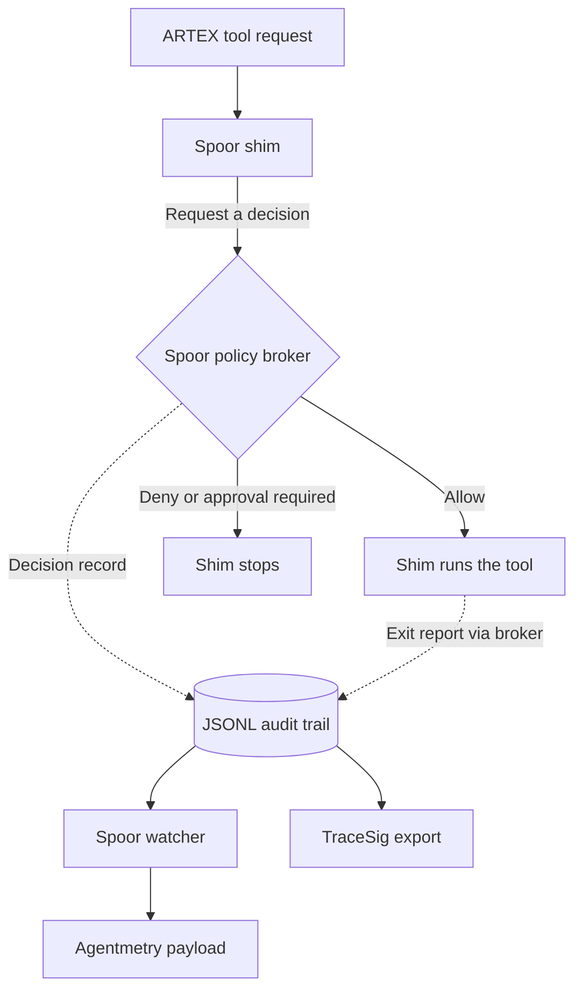
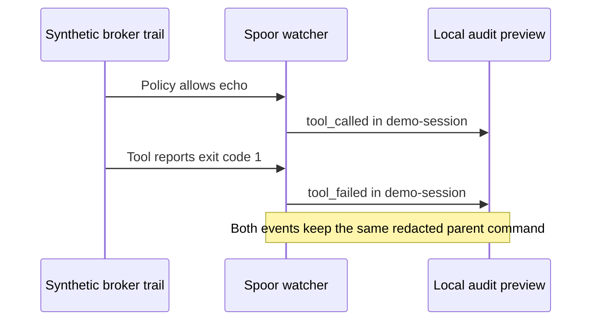

# Spoor

**Follow an ARTEX tool call from policy decision to audit evidence.**

An ARTEX worker asks to run a tool. Spoor can show what it requested, whether
policy allowed it, and what the tool reported afterward. It's an experimental
Rust broker and audit bridge for calls instrumented in a controlled lab.

Microsoft and the FBI documented ARTEX use in real intrusions in November 2026.
Spoor gives defenders a small, reproducible way to study the tool-call evidence
an instrumented agent can leave. [Microsoft Threat Intelligence](https://www.microsoft.com/en-us/security/blog/2026/11/06/artex-abuse-expands-as-cybercriminals-target-financial-sector/) · [FBI advisory](https://www.ic3.gov/CSA/2026/261113.pdf)

[Try a synthetic trace](#try-a-synthetic-trace) ·
[Explore the detections](#detection-rules) ·
[See what has been verified](#verification)

## Where Spoor sees the call



The broker gives each decision a call ID. An allowed tool's report uses that ID,
and Spoor carries the original session and parent command into the report. On
Linux the shim samples the parent command and redacts common credential patterns.

## Try a synthetic trace

Use a stable Rust toolchain with Cargo and Python 3.10 or newer. The same
command works in PowerShell and Bash. The example reads two synthetic records
and prints the local preview without contacting ARTEX or Agentmetry.

```sh
python scripts/run_synthetic_trace.py
```

### Read the two events together



`tool_called` tells you the broker allowed the request. `tool_failed` tells you
the command exited with an error. Both events have `demo-session` and carry
`synthetic-parent --token=[REDACTED]` in `tool.arguments.parent_command_line`.

## Detection rules

- [Sigma](detections/sigma) covers brokered tool activity with ARTEX or shell
  parent metadata, plus web log signals such as ARTEX user agents.
- [Suricata](detections/suricata/artex-lab.rules) looks for ARTEX HTTP signals
  where the relevant traffic is visible.
- [TraceSig](detections/tracesig/lab_rules.yml) looks for sequences across the
  audit trail, including scope drift and risky data movement.

Use these experimental matches as leads to investigate alongside the rest of
the event and your environment's baseline.

## Repository layout

| Path | Contents |
| --- | --- |
| `rust/spoor` | Broker, audit watcher, model request proxy, and TraceSig exporter |
| `rust/spoor-core` | Policy, event mapping, deduplication, and signal matching |
| `rust/spoor-shim` | Tool mediation and Linux parent command capture |
| `rust/policy.json` | Example policy from the local lab |
| `detections` | Experimental Sigma, Suricata, and TraceSig rules |
| `examples` | Synthetic broker trail used in the quick start |

## Verification

[CI](https://github.com/blitzcrieg1/spoor/actions/workflows/ci.yml) builds the
checkout, runs the Rust tests and this quick start, and checks the Sigma
process fixtures on Linux and Windows.

The source lab passed 42 Rust tests with one ignored benchmark and 77 replay
cases. Those replay cases belong to the source lab. The quick start and Sigma
fixtures above are included in this repository.

An isolated Spoor broker and watcher also delivered a synthetic decision and
failure to a running Agentmetry instance. Both events were read back with the
same session and correlation ID and a redacted
`tool.arguments.parent_command_line`. Agentmetry recorded the failure as
`action.type=tool_called` with an error outcome and retained `tool_failed` in
the source topic. The check used synthetic telemetry on loopback.

Build and test the Rust workspace.

```sh
cargo build --locked --manifest-path rust/Cargo.toml --workspace
cargo test --locked --manifest-path rust/Cargo.toml --workspace
```

The focused process rule fixture check uses Python and PyYAML.

```sh
python scripts/evaluate_lab_sigma.py
```

## Deployment limits

The broker listens on loopback by default and assumes a trusted client. Use
operating system and network controls for isolation. Review the example
policy, which permits unmatched commands.

Audit trails can contain command arguments and model prompt content. Parent
command redaction covers common credential patterns. For audit data handling
and private vulnerability reporting, see the [security policy](SECURITY.md).

## License and attribution

Spoor's original code is licensed under the [Apache License 2.0](LICENSE).
Selected detection rules were adapted from ThreatDefence and retain the
[ThreatDefence MIT notice](detections/LICENSE-THREATDEFENCE).
[ThreatDefence reference snapshot](https://github.com/ThreatDefence/agentic-attack-detections/tree/7a29e1683b0b2100baf4b1986870c12e7ffe4a2a)
